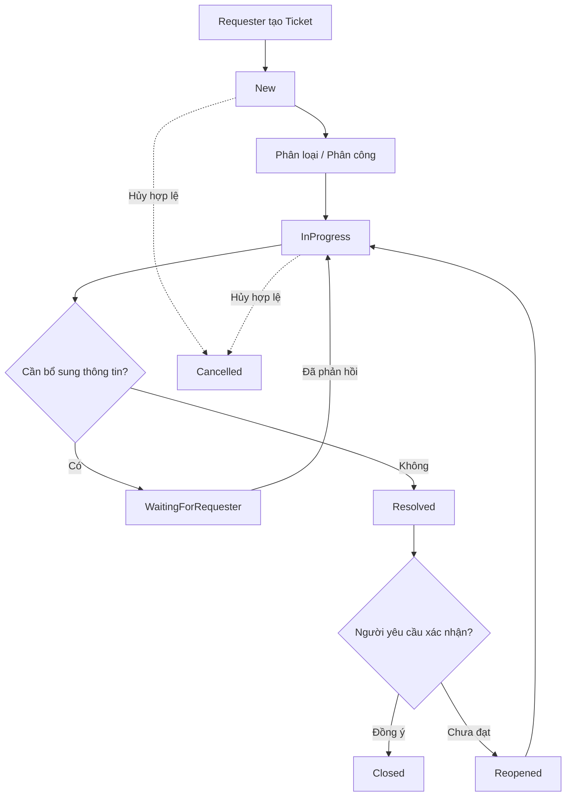
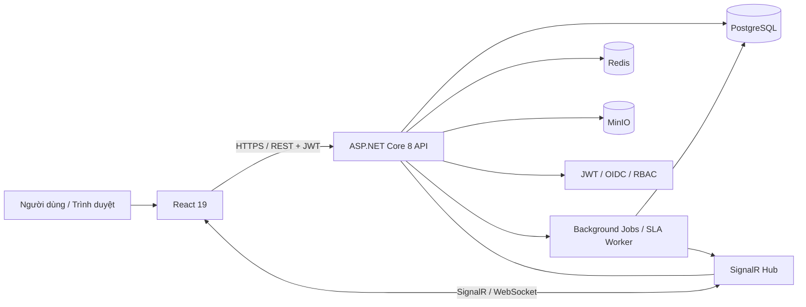
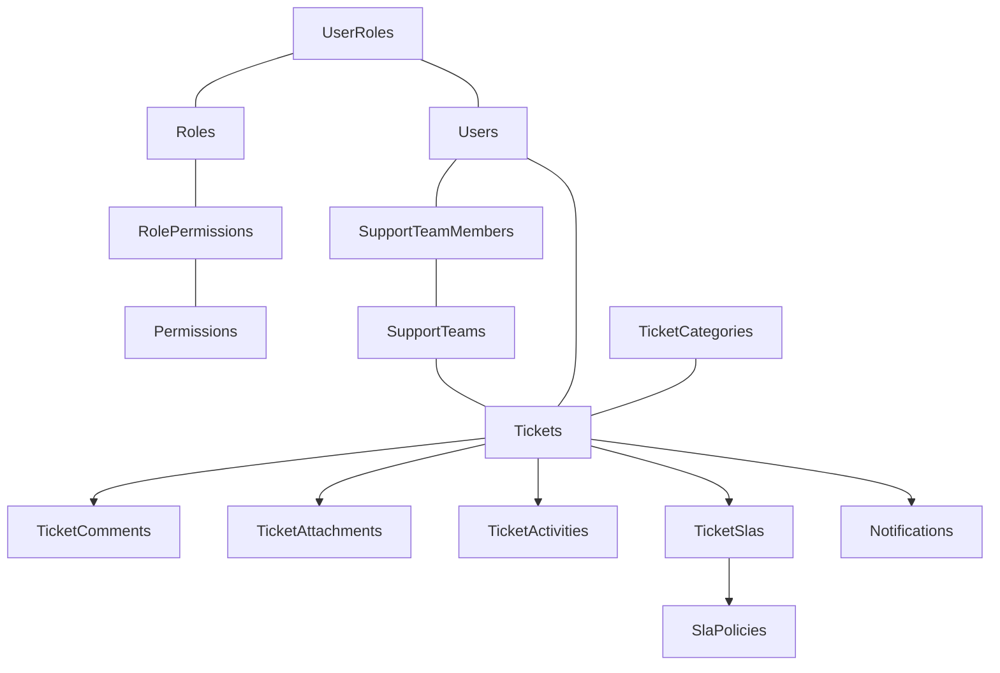

# Helpdesk Management System

> **Đề tài đồ án tốt nghiệp:** Xây dựng hệ thống tiếp nhận và xử lý yêu cầu hỗ trợ (Helpdesk) trên nền tảng Web.
>
> **Frontend:** React `^19.3.1` · **Backend:** ASP.NET Core (`net8.0`) · **Database:** PostgreSQL · **Realtime:** SignalR · **Cache:** Redis · **File Storage:** MinIO · **Triển khai:** Docker

## 1. Giới thiệu

**Helpdesk Management System** là ứng dụng web giúp doanh nghiệp tiếp nhận, phân loại, phân công, xử lý và theo dõi các yêu cầu hỗ trợ (_ticket_) từ nhân viên/người dùng nội bộ. Thay vì gửi yêu cầu rời rạc qua email, tin nhắn hoặc điện thoại, người dùng tạo ticket tại một nơi duy nhất và theo dõi được toàn bộ quá trình giải quyết.

Hệ thống tập trung vào bốn bài toán:

1. **Tập trung yêu cầu:** quản lý tất cả ticket, nội dung trao đổi và tệp đính kèm trên một nền tảng.
2. **Chuẩn hóa quy trình:** phân loại yêu cầu, phân công nhóm/nhân viên phụ trách, kiểm soát vòng đời ticket.
3. **Minh bạch và đo lường:** ghi lịch sử thay đổi, theo dõi thời hạn SLA, hiệu suất xử lý và mức độ tồn đọng.
4. **Phản hồi kịp thời:** cập nhật trạng thái và thông báo theo thời gian thực, kể cả khi có nhiều người cùng làm việc.

**Phạm vi phiên bản MVP:** một doanh nghiệp, nhiều phòng ban và nhóm hỗ trợ. Chưa triển khai đa doanh nghiệp (_multi-tenant_) và chưa phụ thuộc AI để vận hành các chức năng cốt lõi.

### 1.1. Mục tiêu

- Xây dựng giao diện web thân thiện cho người gửi yêu cầu, nhân viên hỗ trợ, trưởng nhóm và quản trị viên.
- Quản lý vòng đời ticket và lịch sử thao tác một cách nhất quán.
- Phân quyền theo vai trò (**RBAC**) kết hợp kiểm tra quyền trên từng ticket.
- Triển khai đăng nhập bằng tài khoản hệ thống và hỗ trợ đăng nhập qua nhà cung cấp danh tính bằng **OIDC/OAuth 2.0**.
- Tích hợp SignalR, Redis và MinIO theo đúng mục đích: realtime, cache, lưu trữ file.
- Hỗ trợ Docker để thiết lập môi trường phát triển và triển khai thuận tiện.
- Có thể mở rộng sau này với AI để phân loại yêu cầu, đề xuất nhóm xử lý và tìm kiếm tri thức.

### 1.2. Đối tượng sử dụng

Ví dụ, trong công ty có phòng IT, Nhân sự, Kế toán và Kinh doanh. Nhân viên tạo ticket khi gặp vấn đề về máy tính, tài khoản, quyền truy cập hoặc quy trình hành chính; hệ thống chuyển ticket đến nhóm phụ trách và lưu lại kết quả xử lý.

## 2. Trạng thái dự án

Tài liệu này mô tả **phạm vi và thiết kế mục tiêu của hệ thống**, không khẳng định mọi chức năng đã được lập trình.

| Hạng mục                                           | Trạng thái tại thời điểm soạn README | Ghi chú                                                                     |
| -------------------------------------------------- | ------------------------------------ | --------------------------------------------------------------------------- |
| Phân tích nghiệp vụ và mô hình dữ liệu 18 entities | Đã thiết kế                          | Có thiết kế schema, entities, quan hệ và constraints                        |
| Bộ mã EF Core Schema Starter từ giai đoạn trước    | Có bản khởi tạo riêng                | **Bản cũ target .NET 10 / EF Core 10**, chưa phải backend `net8.0` hiện tại |
| Backend API nghiệp vụ                              | Dự kiến                              | Auth, ticket, comment, SLA, notification, report                            |
| Frontend React `^19.3.1`                           | Stack đã chọn                        | Chưa có mã frontend được cung cấp trong phạm vi tài liệu này                |
| SignalR / Redis / MinIO nghiệp vụ                  | Dự kiến                              | Hạ tầng có thể chạy bằng Docker; chức năng cần được tích hợp                |
| AI                                                 | Sau MVP, nếu còn thời gian           | Không phải yêu cầu bắt buộc                                                 |

**Backend hiện đã khởi tạo:** Domain, persistence/migration, nền tảng API, seed Identity/bootstrap admin, login email/mật khẩu, JWT validation, `/api/v1/users/me`, refresh token rotation/logout và permission policies đọc trạng thái tài khoản/quyền hiện tại từ database. Profile Docker tiếp tục tự seed/bootstrap admin khi cần. Xem [API Authentication](docs/backend-authentication.md), [quản lý phiên](docs/backend-sessions.md), [phân quyền](docs/backend-authorization.md), [nền tảng Identity](docs/backend-identity-foundation.md) và [persistence](docs/backend-persistence.md). Chưa có UI đăng nhập hoặc workflow Ticket.

**CI:** GitHub Actions kiểm tra backend với PostgreSQL riêng, lint/build frontend và build Docker khi push hoặc mở pull request. Xem [cấu hình và cách sử dụng](docs/github-actions.md).

**Quản trị tài khoản:** Đã có API user/status, cấp role theo scope, quản lý grant với `role.manage`, đổi mật khẩu/revoke toàn bộ phiên và audit. Xem [API quản trị](docs/backend-accounts.md). Code này yêu cầu [migration AccountAdministration đã review](docs/account-administration-review.md); database thật chưa được tự nâng cấp. Model hiện gồm 18 entity lõi và IdentityAuditLog.

**Phòng ban:** Đã có API danh sách/chi tiết/tạo/sửa/activate/deactivate với `department.manage`, lookup cho `user.manage`, kiểm tra gán user và giữ liên kết lịch sử. Xem [API phòng ban](docs/backend-departments.md) và [SQL DepartmentAdministration cần review trước khi áp dụng](docs/department-administration-review.md). Phần 6 đã được người dùng xác nhận nâng cấp; phần 7 có migration mới, không tự apply khi F5.

**Kế hoạch tiếp theo:** [Lộ trình backend](docs/backend-roadmap.md); bước 8 triển khai nhóm hỗ trợ và thành viên, sau đó danh mục và các luồng Ticket.

> **Quan trọng:** Không sử dụng trực tiếp package EF Core 10 trong project `net8.0`. Phải chuyển project cũ từ `net10.0` sang `net8.0` và thay các gói EF Core/Npgsql/NamingConventions bằng phiên bản **8.x tương thích** trước khi tạo migration. Mọi ví dụ endpoint/cấu trúc module ở README đều là **đề xuất thiết kế**, cần điều chỉnh theo source code thực tế khi triển khai.

## 3. Công nghệ sử dụng

| Lớp               | Công nghệ                                    | Vai trò                                           |
| ----------------- | -------------------------------------------- | ------------------------------------------------- |
| Frontend          | React `^19.3.1`                              | Giao diện SPA, trang quản lý ticket, dashboard    |
| Frontend tooling  | Vite (đề xuất)                               | Phát triển, build và phục vụ frontend             |
| Frontend HTTP     | Fetch/Axios (tùy chọn)                       | Kết nối REST API                                  |
| Backend           | ASP.NET Core `net8.0`                        | REST API, xử lý nghiệp vụ và phân quyền           |
| ORM               | Entity Framework Core **8.x**                | Code First, Fluent API, migrations                |
| Database          | PostgreSQL (Docker)                          | Nguồn dữ liệu chính (_source of truth_)           |
| Authentication    | JWT + Refresh Token; OIDC/OAuth 2.0          | Xác thực, quản lý phiên và đăng nhập ngoài        |
| Authorization     | RBAC + kiểm tra sở hữu/phạm vi dữ liệu       | Kiểm soát thao tác và dữ liệu truy cập            |
| Realtime          | ASP.NET Core SignalR                         | Sự kiện ticket và thông báo realtime              |
| Cache             | Redis                                        | Cache dữ liệu đọc nhiều, hỗ trợ hiệu năng         |
| Object Storage    | MinIO                                        | Lưu file đính kèm riêng tư                        |
| API Documentation | Swagger/OpenAPI (đề xuất)                    | Kiểm thử và mô tả REST endpoints                  |
| Containerization  | Docker, Docker Compose                       | Đóng gói dịch vụ và quản lý hạ tầng               |
| Testing           | xUnit, integration test, k6/JMeter (đề xuất) | Kiểm thử nghiệp vụ, tích hợp và hiệu năng         |
| AI                | Tùy chọn sau MVP                             | Phân loại ticket, gợi ý câu trả lời, tìm tài liệu |

**Chính sách phiên bản:** .NET 8 hết hỗ trợ ngày **10/11/2026** theo Microsoft; nếu đồ án tiếp tục vận hành sau mốc này, cần lên kế hoạch cập nhật sang một phiên bản .NET còn được hỗ trợ. Tham khảo: <https://dotnet.microsoft.com/en-us/platform/support/policy>.

## 4. Vai trò và phân quyền

Một người dùng có thể đảm nhận **nhiều vai trò**. Quyền được xác định thông qua `User → UserRole → Role → RolePermission → Permission`.

| Vai trò           | Trách nhiệm chính                                                                             |
| ----------------- | --------------------------------------------------------------------------------------------- |
| **Requester**     | Tạo ticket; xem các ticket được phép; gửi bình luận và file; xác nhận kết quả; yêu cầu mở lại |
| **Support Agent** | Xem ticket thuộc phạm vi; tiếp nhận, xử lý, gửi phản hồi; ghi chú nội bộ; cập nhật trạng thái |
| **Team Leader**   | Theo dõi ticket của nhóm; phân công/điều phối agent; giám sát SLA và hiệu suất                |
| **System Admin**  | Quản lý tài khoản, role, permission, danh mục, nhóm hỗ trợ và cấu hình hệ thống               |

### 4.1. Một số quyền đề xuất

| Permission                | Ý nghĩa                                        |
| ------------------------- | ---------------------------------------------- |
| `ticket.create`           | Tạo ticket                                     |
| `ticket.read.own`         | Đọc ticket thuộc phạm vi cá nhân               |
| `ticket.read.team`        | Đọc ticket thuộc nhóm hỗ trợ                   |
| `ticket.read.all`         | Đọc mọi ticket theo chính sách quản trị        |
| `ticket.assign`           | Phân công ticket                               |
| `ticket.update.status`    | Cập nhật trạng thái ticket                     |
| `ticket.comment.public`   | Bình luận công khai                            |
| `ticket.comment.internal` | Tạo/đọc ghi chú nội bộ trong phạm vi được phép |
| `ticket.manage.sla`       | Cấu hình chính sách SLA                        |
| `user.manage`             | Quản lý người dùng                             |
| `team.manage`             | Quản lý nhóm hỗ trợ                            |

> **RBAC không đủ nếu chỉ kiểm tra Role.** Backend luôn kiểm tra thêm quyền truy cập **đúng ticket**, nhóm hỗ trợ, người được phân công và `is_internal`. Chỉ ẩn nút trên React không được coi là bảo mật.

## 5. Chức năng hệ thống

### 5.1. Tài khoản và xác thực

- Đăng nhập bằng email/mật khẩu; mật khẩu được hash an toàn.
- Đăng nhập qua nhà cung cấp danh tính như Google/Microsoft (OIDC trên OAuth 2.0).
- Phát hành Access Token (JWT), Refresh Token; hỗ trợ làm mới và thu hồi phiên.
- Quản lý hồ sơ, avatar, trạng thái tài khoản, phòng ban.
- Quản lý roles và permissions; kiểm tra quyền tại backend.

### 5.2. Quản lý ticket

- Tạo ticket với tiêu đề, mô tả, danh mục, mức ưu tiên và file đính kèm.
- Tự sinh mã ticket hiển thị như `HD-000001` từ số thứ tự do PostgreSQL tạo.
- Lọc, tìm kiếm, phân trang theo mã, người yêu cầu, trạng thái, mức ưu tiên, danh mục, nhóm, nhân viên và thời gian.
- Phân công nhóm hỗ trợ/agent; có thể thay đổi phân công với lịch sử đầy đủ.
- Cập nhật trạng thái theo quy tắc chuyển trạng thái hợp lệ.
- Xem timeline hoạt động của ticket.
- Ngăn ghi đè dữ liệu khi nhiều agent chỉnh sửa đồng thời.

### 5.3. Trao đổi và tệp đính kèm

- Bình luận công khai giữa requester và nhân viên hỗ trợ.
- Ghi chú nội bộ (_internal note_) cho người có quyền.
- Đính kèm tài liệu, ảnh chụp màn hình hoặc file log.
- Lưu **metadata** file trong PostgreSQL, **nội dung file** trong MinIO.
- Kiểm tra quyền và thời hạn truy cập khi cung cấp file tải xuống.
- Đảm bảo file gắn với comment phải thuộc đúng ticket.

### 5.4. SLA (Service Level Agreement)

- Thiết lập thời hạn phản hồi đầu tiên và thời hạn giải quyết theo mức ưu tiên.
- Tính deadline khi áp dụng chính sách; lưu deadline đã áp dụng trên từng ticket.
- Theo dõi ticket sắp quá hạn/đã quá hạn; hiển thị cảnh báo.
- Phản hồi đầu tiên chỉ được tính khi có phản hồi **công khai, hợp lệ** từ nhân viên hỗ trợ.
- MVP tính SLA theo **24/7**; tính theo lịch làm việc, ngày nghỉ và tạm dừng SLA là hướng nâng cao.

| Priority | Phản hồi đầu tiên | Giải quyết | Ghi chú                         |
| -------- | ----------------: | ---------: | ------------------------------- |
| Low      |             8 giờ |     72 giờ | Giá trị minh họa, cấu hình được |
| Normal   |             4 giờ |     24 giờ | Giá trị minh họa                |
| High     |             1 giờ |      8 giờ | Giá trị minh họa                |
| Urgent   |           15 phút |      4 giờ | Giá trị minh họa                |

### 5.5. Thông báo và realtime

- Thông báo khi được phân công ticket hoặc khi ticket thay đổi trạng thái.
- Thông báo khi có bình luận mới, khi ticket được mở lại hoặc gần vi phạm SLA.
- Lưu thông báo trong PostgreSQL để người dùng offline vẫn xem lại được.
- SignalR chỉ phát sự kiện đến người dùng/nhóm đã xác thực và được phép nhận.
- Cập nhật danh sách ticket và số lượng thông báo chưa đọc trên giao diện.

### 5.6. Quản trị và báo cáo

- Quản lý phòng ban, nhóm hỗ trợ, thành viên, danh mục yêu cầu.
- Dashboard: ticket mới, đang xử lý, đã giải quyết, quá hạn.
- Theo dõi thời gian phản hồi, thời gian xử lý, tỷ lệ đáp ứng SLA.
- Báo cáo số ticket theo danh mục, mức ưu tiên, nhóm và nhân viên.
- Bộ lọc thời gian, xuất báo cáo (CSV/Excel: tính năng mở rộng).

## 6. Quy trình nghiệp vụ (Ticket Lifecycle)

### 6.1. Trạng thái ticket

| Status                | Ý nghĩa                                          |
| --------------------- | ------------------------------------------------ |
| `New`                 | Ticket vừa được tạo                              |
| `InProgress`          | Đã được tiếp nhận và đang xử lý                  |
| `WaitingForRequester` | Cần thêm thông tin từ người gửi                  |
| `Resolved`            | Nhân viên đã đưa ra phương án/kết quả giải quyết |
| `Closed`              | Ticket được xác nhận hoàn tất                    |
| `Cancelled`           | Ticket bị hủy theo chính sách                    |
| `Reopened`            | Ticket được mở lại do kết quả chưa đạt           |



### 6.2. Quy tắc nghiệp vụ cốt lõi

1. Ticket tạo mới có trạng thái `New`; có thể chưa có agent phụ trách.
2. Khi phân công agent, phải xác minh agent **đang hoạt động** và **thuộc nhóm được giao**.
3. Chuyển sang `Resolved` bắt buộc có `resolution_summary` và `resolved_at`.
4. Chuyển sang `Closed` phải ghi `closed_at`; không cho sửa tùy tiện sau khi đóng.
5. Requester chỉ xem được nội dung công khai; internal note và internal attachment không bị lộ qua REST API hoặc SignalR.
6. Thay đổi quan trọng phải ghi `TicketActivity` trong **cùng giao dịch** với cập nhật Ticket.
7. Khi hai người đồng thời sửa Ticket, xử lý `DbUpdateConcurrencyException` và phản hồi xung đột (`409 Conflict`) thích hợp.
8. Các nghiệp vụ SLA (đổi ưu tiên, mở lại, tạm dừng) phải có quy tắc rõ ràng; MVP không tự động tính lại hạn xử lý nếu chưa được đặc tả.
9. Notification được lưu bền vững; SignalR là kênh đẩy sự kiện, không thay thế lưu trữ.
10. Không xóa cascade các tài khoản/ticket đã phát sinh lịch sử nghiệp vụ.

## 7. Kiến trúc tổng thể

Đề xuất triển khai theo **modular monolith**: một ASP.NET Core backend, các module nghiệp vụ tách biệt về mã nguồn, một PostgreSQL database chia schema. Không cần microservices trong phạm vi đồ án.



**Nguyên tắc:**

- **React:** hiển thị, quản lý state, kiểm tra đầu vào phía giao diện; không tự quyết định quyền truy cập.
- **ASP.NET Core:** nơi xử lý và kiểm soát nghiệp vụ, validation, authorization, transactions, API và SignalR.
- **PostgreSQL:** nguồn dữ liệu chính cho users, tickets, activities, SLA và notifications.
- **Redis:** cache có TTL và chiến lược invalidation; không dùng thay DB để lưu ticket.
- **MinIO:** lưu nội dung file; truy cập được cấp quyền qua backend.
- **Background worker:** kiểm tra SLA, tạo thông báo, chạy tác vụ không cần chặn HTTP request.

### 7.1. Luồng tạo ticket (đề xuất)

1. Requester nhập yêu cầu trên React, đính kèm file nếu cần.
2. React gọi REST API kèm thông tin xác thực.
3. Backend kiểm tra quyền, dữ liệu, category và quy tắc phân công.
4. Backend tạo ticket, SLA snapshot và activity trong PostgreSQL transaction.
5. Backend hoàn tất lưu file/metadata theo chiến lược xử lý lỗi đã thiết kế.
6. Sau khi commit thành công, backend tạo/đẩy notification cho các đối tượng liên quan.
7. React cập nhật giao diện và timeline. Nếu cần giao nhận sự kiện tin cậy, bổ sung **Transactional Outbox**.

### 7.2. Luồng truy cập file

- Frontend yêu cầu xem/tải file theo `attachmentId`, không nhận quyền tự do truy cập bucket.
- Backend kiểm tra người dùng được xem ticket và cấp quyền phù hợp với `is_internal`.
- Sau kiểm tra, backend stream file hoặc cấp **presigned URL ngắn hạn** từ MinIO.
- Giới hạn kích thước, định dạng, đường dẫn, tên file; cân nhắc quét mã độc trong môi trường thực tế.

## 8. Thiết kế cơ sở dữ liệu

**Database:** PostgreSQL; cách tổ chức: **18 entities thuộc 4 PostgreSQL schemas**.

| PostgreSQL schema | Entity/table                                                                                                | Mục đích                                         |
| ----------------- | ----------------------------------------------------------------------------------------------------------- | ------------------------------------------------ |
| `identity`        | `User`, `ExternalIdentity`, `Role`, `Permission`, `UserRole`, `RolePermission`, `RefreshToken`              | Tài khoản, đăng nhập, phiên, RBAC                |
| `organization`    | `Department`, `SupportTeam`, `SupportTeamMember`                                                            | Phòng ban và cơ cấu nhóm hỗ trợ                  |
| `helpdesk`        | `TicketCategory`, `Ticket`, `TicketComment`, `TicketAttachment`, `TicketActivity`, `SlaPolicy`, `TicketSla` | Ticket, trao đổi, file, lịch sử và SLA           |
| `communication`   | `Notification`                                                                                              | Thông báo có khả năng lưu trữ và đánh dấu đã đọc |

Cột/tên bảng trong PostgreSQL sử dụng `snake_case`; entity và property C# dùng `PascalCase`.

### 8.1. Các quan hệ chính

- User ↔ Role: **N–N**, qua `UserRole`.
- Role ↔ Permission: **N–N**, qua `RolePermission`.
- User ↔ SupportTeam: **N–N**, qua `SupportTeamMember`.
- Department → User: **1–N**; Department → SupportTeam: **1–N**.
- Ticket → User: `RequesterId`, `CreatedByUserId`, `AssignedAgentId` là **ba FK độc lập**.
- Ticket → TicketCategory: **N–1**, danh mục có quan hệ cha-con.
- Ticket → TicketComment / TicketAttachment / TicketActivity: **1–N**.
- Ticket ↔ TicketSla: **1–0..1**.
- Ticket → Notification: **1–N** (tùy chọn thông báo có liên quan ticket).



### 8.2. Các nguyên tắc lưu trữ

- Dùng **UUID/Guid** cho PK nghiệp vụ; `ticket_number` kiểu `bigint` tự tăng để hiển thị dễ đọc.
- Dùng `timestamptz`, xử lý thời gian ở UTC.
- `Ticket.Version` kiểu `uint` được ánh xạ tới PostgreSQL system column **`xmin`** bằng Npgsql để xử lý optimistic concurrency; đây không phải cột `version` thông thường.
- `Status` và `Priority` dùng C# enum ánh xạ chuỗi có ràng buộc giá trị hợp lệ trong DB.
- Lịch sử thay đổi có thể lưu `old_value` / `new_value` bằng `jsonb`.
- Index cho tìm ticket theo requester, team, agent, status, created_at; index comment/activity theo ticket và thời gian.
- Foreign key quan trọng dùng `Restrict`/`NoAction` để hạn chế mất dữ liệu.
- Refresh token phải **lưu hash**, không lưu raw token.

## 9. Thiết kế REST API (dự kiến)

> Danh sách dưới đây là **API contract tham khảo**, **chưa khẳng định đã được triển khai**. Prefix đề xuất: `/api/v1`.

| Method  | Endpoint                            | Ý nghĩa                               |
| ------- | ----------------------------------- | ------------------------------------- |
| `POST`  | `/api/v1/auth/login`                | Đăng nhập bằng tài khoản hệ thống     |
| `POST`  | `/api/v1/auth/refresh`              | Làm mới access token                  |
| `POST`  | `/api/v1/auth/logout`               | Thu hồi refresh token                 |
| `GET`   | `/api/v1/users/me`                  | Hồ sơ người dùng                      |
| `GET`   | `/api/v1/tickets`                   | Danh sách ticket có lọc và phân trang |
| `POST`  | `/api/v1/tickets`                   | Tạo ticket                            |
| `GET`   | `/api/v1/tickets/{id}`              | Chi tiết ticket                       |
| `PATCH` | `/api/v1/tickets/{id}`              | Cập nhật thông tin được phép sửa      |
| `POST`  | `/api/v1/tickets/{id}/assign`       | Phân công ticket                      |
| `POST`  | `/api/v1/tickets/{id}/transition`   | Thực hiện chuyển trạng thái hợp lệ    |
| `GET`   | `/api/v1/tickets/{id}/activities`   | Lịch sử hoạt động                     |
| `GET`   | `/api/v1/tickets/{id}/comments`     | Danh sách bình luận có kiểm tra quyền |
| `POST`  | `/api/v1/tickets/{id}/comments`     | Bình luận / ghi chú nội bộ            |
| `POST`  | `/api/v1/tickets/{id}/attachments`  | Upload file                           |
| `GET`   | `/api/v1/attachments/{id}/download` | Tải file sau khi kiểm tra quyền       |
| `GET`   | `/api/v1/notifications`             | Danh sách thông báo                   |
| `PATCH` | `/api/v1/notifications/{id}/read`   | Đánh dấu đã đọc                       |
| `GET`   | `/api/v1/reports/overview`          | Số liệu dashboard                     |
| `GET`   | `/api/v1/admin/support-teams`       | Quản lý nhóm hỗ trợ                   |
| `GET`   | `/api/v1/admin/sla-policies`        | Chính sách SLA                        |

Chuẩn response đề xuất: dữ liệu/metadata thống nhất; lỗi dùng HTTP status thích hợp (`400`, `401`, `403`, `404`, `409`, `422`, `500`) và `ProblemDetails`. Không trả Entity Framework entity trực tiếp ra frontend; dùng Request/Response DTO.

### 9.1. SignalR Hub (dự kiến)

- Hub path: `/hubs/notifications` (có thể bổ sung `/hubs/tickets` nếu cần).
- Event ví dụ: `TicketCreated`, `TicketAssigned`, `TicketUpdated`, `CommentAdded`, `NotificationReceived`, `SlaWarning`.
- Event phải chứa dữ liệu tối thiểu, không phát nội dung nội bộ đến người dùng không có quyền.
- Phải xác thực kết nối, kiểm tra quyền tham gia group và xử lý quyền thay đổi khi kết nối đang mở.

## 10. Cấu trúc mã nguồn đề xuất

Ví dụ nếu frontend/backend tách thư mục trong **một repository**:

```text
Helpdesk/
├── fe/                     # React ^19.3.1 (ví dụ: Vite)
│   ├── src/
│   │   ├── app/                   # Router, providers, config
│   │   ├── components/            # Shared UI
│   │   ├── features/
│   │   │   ├── auth/
│   │   │   ├── tickets/
│   │   │   ├── notifications/
│   │   │   ├── teams/
│   │   │   └── dashboard/
│   │   ├── services/              # REST client, SignalR client
│   │   └── utils/
│   ├── package.json
│   └── .env.example
├── be/
│   ├── src/
│   │   ├── Helpdesk.Api/         # Controllers, middleware, DI
│   │   ├── Helpdesk.Application/ # Use cases, DTOs, validation
│   │   ├── Helpdesk.Domain/      # Entities, enums, business rules
│   │   └── Helpdesk.Infrastructure/ # EF Core, Redis, MinIO, auth
│   └── tests/
│       ├── Helpdesk.UnitTests/
│       └── Helpdesk.IntegrationTests/
├── deploy/
│   └── docker-compose.yml
├── docs/                         # SRS, ERD, use cases, API docs
└── README.md
```

Cấu trúc trên là **đích kiến trúc**, không phải cấu trúc đã có sẵn trong bộ Schema Starter cũ. Có thể bắt đầu với 1 project ASP.NET Core đơn giản rồi tách thành các project khi nghiệp vụ ổn định.

## 11. Thiết lập môi trường phát triển

**Hạ tầng local đã có:** dùng `docker-compose.yml` tại root và làm theo [hướng dẫn backend](docs/backend-setup.md) để chạy PostgreSQL, Redis, MinIO và API .NET 8. Các ví dụ Schema Starter dưới đây là tham khảo; hướng dẫn mới phản ánh cấu hình thực tế hiện tại. Backend đã có EF Core mapping và InitialCreate; chưa có client Redis/MinIO. Áp dụng migration là thao tác riêng sau review SQL.

### 11.1. Yêu cầu

- **.NET SDK 8.x** (`dotnet --version`).
- **Node.js** và npm tương thích với phiên bản Vite được chọn (`node --version`, `npm --version`).
- **Docker Desktop** hoặc Docker Engine + Compose (`docker compose version`).
- Git; IDE như Visual Studio / VS Code / Rider.
- Bộ mã backend đã chuyển sang `net8.0` và EF Core 8.x.

### 11.2. Chạy hạ tầng Docker

Nếu sử dụng file `docker-compose.yml` của **bộ Schema Starter cũ**, có thể chạy các dịch vụ hạ tầng độc lập (PostgreSQL, Redis, MinIO):

```bash
# Tại thư mục chứa docker-compose.yml của bộ starter
cp .env.example .env
# Chỉnh các mật khẩu trong .env, không commit file này
docker compose up -d postgres redis minio
```

Các cổng **minh họa từ Docker Compose Starter**:

| Dịch vụ       | Địa chỉ local           | Ghi chú                                  |
| ------------- | ----------------------- | ---------------------------------------- |
| PostgreSQL    | `localhost:5432`        | Database `helpdesk` theo Compose Starter |
| Redis         | `localhost:6379`        | Cache                                    |
| MinIO API     | `http://localhost:9000` | Object storage                           |
| MinIO Console | `http://localhost:9001` | Giao diện quản trị                       |

Không nên dùng mật khẩu mặc định trong môi trường production. Nếu sử dụng Docker Compose mới, port và tên service có thể khác.

### 11.3. Cấu hình backend .NET 8

Project backend cần có:

```xml
<TargetFramework>net8.0</TargetFramework>
```

**Nhóm NuGet packages cần tương thích 8.x:**

- `Microsoft.EntityFrameworkCore.*` và `Microsoft.EntityFrameworkCore.Design` **8.x**.
- `Npgsql.EntityFrameworkCore.PostgreSQL` **8.x**.
- `EFCore.NamingConventions` **8.x** (nếu dùng quy ước `snake_case`).
- `Microsoft.EntityFrameworkCore.Tools` **8.x** (nếu dùng Visual Studio Package Manager Console).

Ví dụ cấu hình database bằng **environment variables** (giá trị chỉ dành cho development):

```dotenv
ConnectionStrings__Helpdesk=Host=localhost;Port=5432;Database=helpdesk;Username=helpdesk;Password=<your-local-password>
Redis__Configuration=localhost:6379
Minio__Endpoint=localhost:9000
Minio__AccessKey=<your-access-key>
Minio__SecretKey=<your-secret-key>
Minio__Bucket=helpdesk-attachments
Jwt__Issuer=<your-issuer>
Jwt__Audience=<your-audience>
Jwt__SigningKey=<strong-secret-from-secret-manager>
```

Tên key cấu hình `Redis__...`, `Minio__...` và `Jwt__...` là **gợi ý**, phải đồng bộ với options classes thực tế của backend. Không ghi secrets vào source code hoặc commit `.env`.

Sau khi chuyển các package tương thích và khởi tạo `DbContext`/connection string, có thể chạy:

```bash
# Từ thư mục có .csproj phù hợp
# Dùng dotnet-ef major 8 (cài theo patch phù hợp)
dotnet tool install --global dotnet-ef --version "8.*"

dotnet restore
dotnet build

dotnet ef migrations add InitialCreate
dotnet ef database update

dotnet run
```

Các lệnh trên giả định project chứa `DbContext` cũng là startup project. Với cấu trúc nhiều project, bổ sung `--project` và `--startup-project`. Migration **chỉ nên tạo một lần** cho database chưa có migration tương ứng. Kiểm tra `dotnet-ef --version` và tránh cài đè nếu máy đã cài phiên bản khác.

### 11.4. Chạy frontend React

Nếu React app **đã được tạo** và nằm trong `frontend/`:

```bash
cd fe
npm install
npm run dev
```

Ví dụ cấu hình frontend nếu dùng Vite:

```dotenv
VITE_API_BASE_URL=http://localhost:5000/api/v1
VITE_SIGNALR_URL=http://localhost:5000/hubs/notifications
```

**Lưu ý:** Port `5000` chỉ là ví dụ; lấy URL thực tế từ `launchSettings.json`, terminal `dotnet run` hoặc cấu hình reverse proxy. `VITE_*` là biến build-time có thể đọc được ở trình duyệt, **không dùng để lưu mật khẩu hoặc secret**.

### 11.5. Khởi chạy toàn hệ thống bằng Docker (mục tiêu triển khai)

Khi đã có Dockerfile cho frontend React và backend .NET 8, có thể bổ sung cả hai dịch vụ vào Compose cùng PostgreSQL, Redis và MinIO:

```bash
docker compose up -d --build
```

Đây là **mục tiêu deployment**, chưa phải cam kết lệnh này chạy được từ bộ Schema Starter cũ: Dockerfile cũ đang target .NET 10 và chưa có frontend. Trước khi build cần chuyển base image SDK/runtime sang `8.0`, cập nhật package và kiểm tra toàn bộ service.

## 12. Bảo mật và tính toàn vẹn dữ liệu

- HTTPS tại reverse proxy; CORS chỉ cho phép những origin cần thiết.
- Áp dụng chính sách password hashing an toàn và giới hạn tốc độ đăng nhập.
- Access token có thời hạn ngắn; refresh token được hash, rotate và revoke.
- Với OAuth/OIDC, định danh người dùng bằng `provider + subject`, không chỉ bằng email.
- Xác thực và phân quyền trên **mọi API, SignalR hub và endpoint tải file**.
- Không trả mật khẩu hash, secret, access token hoặc internal note trong API không phù hợp.
- Validate DTO, kiểm soát kích thước file, MIME, quyền tải xuống và tên file.
- Sử dụng EF Core parameterized queries; không nối chuỗi đầu vào vào raw SQL.
- Ghi lịch sử thay đổi ticket trong transaction; dùng optimistic concurrency cho cập nhật đồng thời.
- Xử lý giao dịch DB và upload MinIO cẩn trọng vì không có distributed transaction mặc định.
- Sao lưu PostgreSQL và MinIO; bảo vệ Redis/MinIO khỏi public Internet nếu chưa có lớp xác thực và bảo mật phù hợp.
- Kiểm tra OWASP Top 10 và test IDOR/BOLA, privilege escalation, file upload, token handling.

## 13. Kiểm thử và tiêu chí nghiệm thu

| Nhóm            | Kịch bản cần kiểm thử                                                                    |
| --------------- | ---------------------------------------------------------------------------------------- |
| Authentication  | Sai mật khẩu, token hết hạn, refresh token đã thu hồi, tài khoản khóa                    |
| Authorization   | Requester không đọc ticket người khác; không xem internal note/file                      |
| Ticket workflow | New → InProgress → Resolved → Closed; Reopened; Cancelled hợp lệ                         |
| Assignment      | Không giao cho agent ngoài team hoặc account inactive                                    |
| Concurrency     | Hai agent cập nhật cùng ticket, phát hiện `409 Conflict`                                 |
| SLA             | Tạo deadline đúng; đánh dấu vi phạm theo thời điểm; không tính internal note là phản hồi |
| Realtime        | Nhận notification đúng user/group; offline vẫn xem lại từ DB                             |
| File Storage    | Upload/download đúng ticket; không gắn file sang comment của ticket khác                 |
| Cache           | Không trả dữ liệu cũ sau thao tác làm thay đổi quyền/trạng thái                          |
| Performance     | Đo thời gian phản hồi và thông lượng với các mức tải tăng dần                            |

**Các chỉ tiêu như số CCU, p95 response time hay tỷ lệ lỗi phải được xác định và đo sau khi có môi trường kiểm thử cụ thể**, không đặt số liệu giả thành kết quả đã đạt.

## 14. Lộ trình phát triển gợi ý (16 tuần)

| Giai đoạn                         | Thời gian  | Đầu ra                                                    |
| --------------------------------- | ---------- | --------------------------------------------------------- |
| 1. Khảo sát & phân tích nghiệp vụ | Tuần 1–2   | SRS, use cases, phân quyền, vòng đời ticket               |
| 2. Thiết kế hệ thống & database   | Tuần 3–4   | ERD, entities, Fluent API, migrations, kiến trúc          |
| 3. Authentication & Organization  | Tuần 5–6   | JWT/OIDC, RBAC, users, team, category                     |
| 4. Ticket Management              | Tuần 7–9   | CRUD có nghiệp vụ, assignment, comments, activities, file |
| 5. SLA & Realtime                 | Tuần 10–11 | SLA, notification, SignalR, worker                        |
| 6. Dashboard & tối ưu             | Tuần 12–13 | Report, Redis, indexes, concurrency                       |
| 7. Kiểm thử & triển khai          | Tuần 14–15 | Test report, Docker, security/performance tests           |
| 8. Hoàn thiện đồ án               | Tuần 16    | Báo cáo, demo, tài liệu hướng dẫn, slide bảo vệ           |

## 15. Các tính năng có thể mở rộng

**Không bắt buộc trong MVP:**

- AI tự động phân loại ticket theo nội dung và đề xuất mức ưu tiên.
- AI đề xuất nhóm/nhân viên phù hợp dựa vào lịch sử xử lý.
- AI tóm tắt luồng trao đổi dài, đề xuất câu trả lời cho Agent.
- Kho tri thức `KnowledgeArticle` kết hợp RAG; trả lời có trích dẫn nguồn.
- Tính SLA theo lịch làm việc, ngày nghỉ và cơ chế tạm dừng.
- Ticket watcher, tags, CSAT feedback, escalation nhiều cấp.
- Email integration, báo cáo xuất Excel/PDF, biểu đồ nâng cao.
- Multi-tenant khi phát triển thành sản phẩm SaaS.

Khi bổ sung AI, cần có dữ liệu được phân quyền, cơ chế đánh giá chất lượng, log kiểm chứng và chế độ người dùng phê duyệt kết quả. AI chỉ hỗ trợ, không tự thay đổi ticket/permission khi chưa có quy tắc rõ ràng.

## 16. Tài liệu nên có trong đồ án

- Tài liệu khảo sát, đặc tả yêu cầu (**SRS**).
- Use Case Diagram và Use Case Specifications.
- Activity Diagram / Sequence Diagram cho tạo ticket, phân công, chuyển trạng thái, SLA.
- ERD, Data Dictionary, Entity/Fluent API Configurations.
- API specification (OpenAPI/Swagger).
- Hướng dẫn cài đặt và triển khai Docker.
- Test cases, kết quả kiểm thử, báo cáo đánh giá hiệu năng/bảo mật.
- Hướng dẫn sử dụng theo từng vai trò và video/demo hệ thống.

## 17. Quy ước phát triển

- C# dùng `PascalCase` cho classes/properties, `camelCase` cho tham số/biến cục bộ.
- PostgreSQL dùng `snake_case` cho schema, table và column.
- Tầng Controller/Endpoint mỏng; nghiệp vụ nằm ở Application/Domain Services.
- Dùng DTO cho API; validation tại application boundary.
- Dùng migration có review thay vì tự sửa schema trên môi trường đã triển khai.
- Commit code theo tính năng, không commit `.env`, `appsettings.Production.json` chứa secret hoặc file dữ liệu nhạy cảm.
- Viết tests cho mọi quy tắc chuyển trạng thái, phân quyền và SLA quan trọng.

## 18. Tóm tắt

Helpdesk Management System là đồ án tập trung vào **quản lý quy trình hỗ trợ thực tế**, không chỉ CRUD. Ba trọng tâm kỹ thuật là:

1. **Ticket Lifecycle + Audit Trail:** workflow rõ ràng, lưu đầy đủ lịch sử thay đổi.
2. **Authentication/Authorization:** JWT, OIDC, RBAC và kiểm tra truy cập ở mức bản ghi.
3. **SLA + Realtime + Concurrency:** theo dõi cam kết thời gian, gửi sự kiện đúng đối tượng và xử lý cập nhật đồng thời an toàn.

Kiến trúc cho phép bổ sung AI về sau mà không ảnh hưởng tới chức năng Helpdesk cốt lõi.

---

**Phạm vi tài liệu:** README tổng quan phục vụ xây dựng đồ án; thay thế các mục “dự kiến” bằng trạng thái triển khai thực tế khi có mã nguồn tương ứng.
