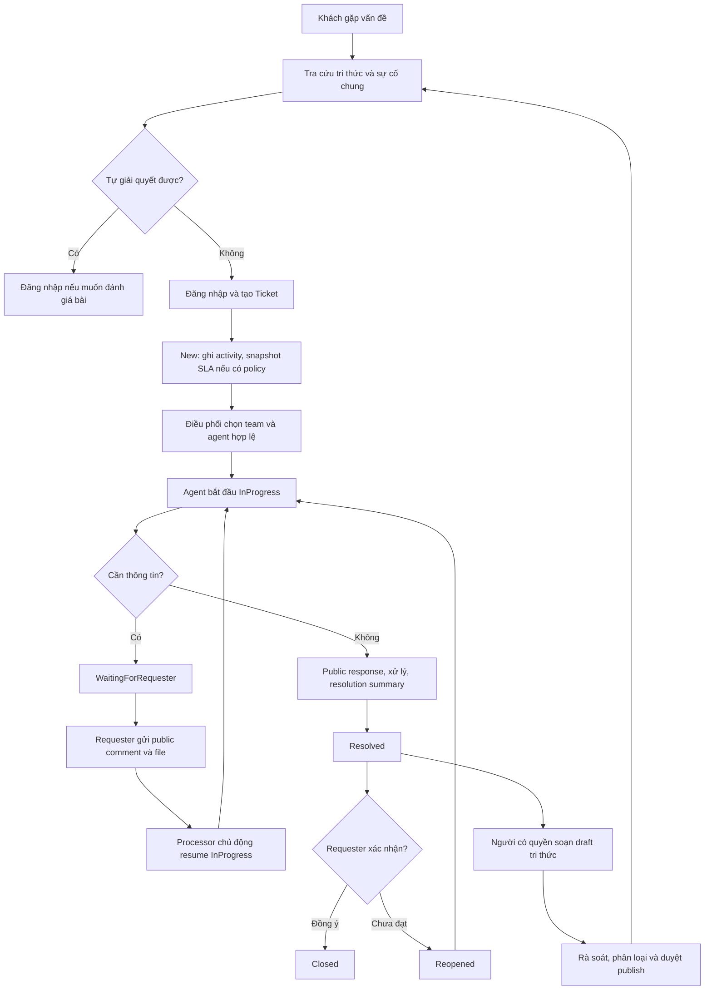
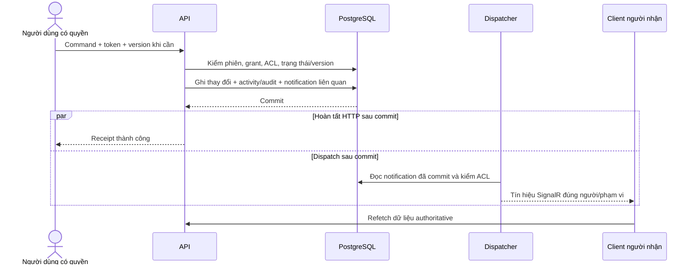

# Use case và luồng nghiệp vụ Helpdesk

Phiên bản đối chiếu source ngày **04/11/2026**. Tài liệu phục vụ phân tích đồ án, hướng dẫn sử dụng và nghiệm thu. Chức năng được mô tả theo code hiện có; trạng thái dữ liệu/quyền của một database cụ thể phải kiểm tra trước khi chạy.

Đọc tiếp theo thứ tự: tài liệu này → [chuẩn bị dữ liệu và thao tác mẫu](testing/uat-guide.md) → [test cases](testing/test-cases.md). File [uat-data.json](testing/uat-data.json) là dữ liệu mẫu để nhập/test, **không phải bằng chứng đã seed hoặc đã chạy test**.

## 1. Phạm vi và tác nhân

Hệ thống tiếp nhận yêu cầu hỗ trợ trong một tổ chức, phân công nhóm/nhân viên, trao đổi theo quyền, theo dõi SLA và tổng hợp báo cáo. Kho tri thức/sự cố cho phép tự tra cứu trước khi đăng nhập. AI local hiện là API chọn đoạn trích đã duyệt kèm nguồn; chưa có màn hình chat hoàn chỉnh.

| Tác nhân | Mục tiêu | Điều kiện thực tế |
| --- | --- | --- |
| Khách chưa đăng nhập | Xem hướng dẫn/sự cố công khai, truy xuất đoạn, gọi API trợ lý | Chỉ snapshot public đúng dataset; không xem Ticket, draft, nội bộ. |
| Requester | Tạo, theo dõi, bổ sung thông tin, xác nhận/mở lại/hủy yêu cầu của mình | Cần permission tương ứng và đúng `RequesterId`. |
| SupportAgent | Đọc yêu cầu trong nhóm, xử lý yêu cầu được giao, ghi chú nội bộ | Membership/team/department active; quyền xử lý còn phụ thuộc assignee hoặc leader. |
| TeamLeader | Điều phối và quản lý thành viên trong phạm vi nhóm phụ trách | Tên role chưa đủ; cần membership active với `IsLeader=true`. |
| SystemAdmin | Quản trị tổ chức, tài khoản, quyền, SLA, nội dung và điều phối toàn cục | Vẫn cần grant hiện tại. Không có cơ chế bỏ qua mọi ACL chỉ bằng tên role. |
| Biên tập viên/người duyệt | Soạn và xuất bản tri thức/sự cố | Là năng lực được cấp qua các permission riêng, không phải role mới bắt buộc. |
| Worker/SignalR | Phát hiện SLA quá hạn, phát tín hiệu sau commit, kiểm tra scope kết nối | Không thay thế dữ liệu lưu trong database; realtime có thể lặp/mất sự kiện. |
| Người vận hành | Deploy, backup, migration, kiểm tra/dựng lại chỉ mục | Thao tác CLI/hạ tầng riêng, không phải quyền tự có của người dùng web. |

Role mặc định mới theo `IdentitySeedCatalog.cs`:

- **Requester:** `ticket.create`, `ticket.read.own`, `ticket.comment.public`, `ticket.confirm`, `ticket.reopen`, `ticket.cancel`.
- **SupportAgent:** toàn bộ nhóm trên + `ticket.read.team`, `ticket.update.status`, `ticket.comment.internal`.
- **TeamLeader:** toàn bộ nhóm Agent + `ticket.assign`, `team.manage`.
- **SystemAdmin:** toàn bộ permission trong catalog, gồm `user.manage`, `role.manage`, `department.manage`, `category.manage`, `ticket.manage.sla`, `knowledge.manage/publish`, `incident.manage/publish`.

Role đã tồn tại có thể đã được sửa grant; seed không tự khôi phục. Kiểm tra `/api/v1/users/me`, catalog role và capability trên tài nguyên trước khi nghiệm thu. Người dùng nhiều role nhận hợp các grant nhưng vẫn chịu điều kiện tài nguyên, đặc biệt quy tắc requester không xem nội bộ của chính Ticket.

## 2. Danh mục use case

| Mã | Use case | Tác nhân chính | Điểm vào |
| --- | --- | --- | --- |
| UC-01 | Đăng nhập và đọc hồ sơ hiện tại | Mọi tài khoản active | `/login`, `/account` |
| UC-02 | Duy trì/kết thúc phiên và tự đổi mật khẩu | Người đã đăng nhập | Header, `/account/password` |
| UC-03 | Quản trị tài khoản | Có `user.manage` | `/admin/users` |
| UC-04 | Gán role, quản lý grant và audit | Có `role.manage`, theo scope | `/admin/roles/assignments`, `/admin/roles`, `/admin/roles/audit` |
| UC-05 | Quản trị phòng ban | Có `department.manage` | `/admin/departments` |
| UC-06 | Quản trị nhóm, membership và leadership | Có `team.manage` và phạm vi | `/admin/teams` |
| UC-07 | Quản trị cây danh mục | Có `category.manage` | `/admin/categories` |
| UC-08 | Tạo yêu cầu hỗ trợ | Có `ticket.create` | `/tickets/new` |
| UC-09 | Tìm kiếm, lọc và đọc Ticket | Có own/team/all read grant | `/tickets`, `/tickets/:id` |
| UC-10 | Phân công nhóm và nhân viên | Có `ticket.assign` và phạm vi | Panel xử lý trên detail |
| UC-11 | Xử lý trạng thái, resolve, confirm, reopen, cancel | Processor/requester/admin đúng phạm vi | Panel xử lý trên detail |
| UC-12 | Trao đổi công khai/nội bộ và đọc activity | Người có Ticket ACL | Khu vực thảo luận trên detail |
| UC-13 | Upload/list/download file | Người có ACL Ticket/comment | Khu vực file và “File của bình luận” |
| UC-14 | Xem và đánh dấu thông báo | Chủ sở hữu notification | Chuông, `/notifications` |
| UC-15 | Đồng bộ realtime theo phiên và Ticket | Người có phiên active | Tự động khi đăng nhập/mở detail |
| UC-16 | Quản trị policy và theo dõi SLA | Quản trị SLA; người đọc Ticket | `/admin/sla-policies`, panel SLA |
| UC-17 | Dashboard và báo cáo theo scope | Người có Ticket read grant | `/dashboard`, `/reports/tickets` |
| UC-18 | Tra cứu/đánh giá tri thức public | Khách/người đăng nhập | `/knowledge` |
| UC-19 | Soạn, duyệt và thu hồi bài tri thức | Biên tập viên/người duyệt | `/admin/knowledge` |
| UC-20 | Công bố sự cố chung và xác nhận ảnh hưởng | Biên tập viên/người duyệt/người dùng | `/admin/incidents`, `/incidents` |
| UC-21 | Nhập BookStack và tham khảo Wikipedia | Biên tập viên/khách | Trang quản trị/public tri thức |
| UC-22 | Tìm đoạn hướng dẫn | Khách | `/knowledge`, API `/api/v1/public/knowledge/retrieve` |
| UC-23 | Hỏi trợ lý AI local có nguồn | Khách qua API | `POST /api/v1/public/assistant` |
| UC-24 | Đối soát/phục hồi chỉ mục | Người vận hành | CLI `knowledge-index` |
| UC-25 | Deploy demo và cập nhật sau push | Người vận hành | Các script self-host/auto deploy |

Các đường dẫn là route frontend; API luôn có prefix `/api/v1` trừ health/hub. Menu không xuất hiện không đồng nghĩa backend đã chặn đủ; test API trực tiếp vẫn cần thiết.

## 3. Use case chi tiết

### UC-01 — Đăng nhập và hồ sơ

**Tiền điều kiện:** user tồn tại, active, có password nội bộ; hệ thống kết nối được DB. **Kích hoạt:** mở `/login` hoặc link yêu cầu phiên.

1. Người dùng nhập email/mật khẩu và chọn **Đăng nhập**.
2. Server xác minh password, trạng thái user; tạo session, trả access/refresh token.
3. Client đọc `/users/me`, xác minh phiên rồi mới render dữ liệu được bảo vệ và menu theo permission.
4. Nếu có `returnTo` nội bộ hợp lệ, điều hướng đến đó; không chấp nhận redirect ra website ngoài.

**Ngoại lệ:** sai mật khẩu/inactive bị từ chối; 429 có thời gian chờ; lỗi mạng không giả lập thành công. **Hậu điều kiện:** một phiên hợp lệ; không lưu password trong response/log. Hệ thống chưa có đăng ký public/OIDC/quên mật khẩu qua email.

### UC-02 — Phiên, logout, đổi mật khẩu

**Tiền điều kiện:** đã đăng nhập. **Luồng chính:** request 401 hợp lệ kích hoạt đúng một refresh đang chạy; server rotate refresh token; request được replay tối đa một lần. Logout thu hồi phiên tương ứng và xóa dữ liệu phiên/cache phía client. Đổi password tại Bảo mật yêu cầu password hiện tại và password mới khác, dài 12–128 ký tự; thành công thu hồi toàn bộ phiên và đưa về login.

**Ngoại lệ:** token hết hạn/thu hồi/tái sử dụng, tài khoản inactive hoặc logout trong lúc refresh không được làm sống lại phiên cũ; 403 không tạo vòng refresh. **Hậu điều kiện:** token cũ bị từ chối theo cơ chế session; kích hoạt lại user không phục hồi phiên đã thu hồi. Reload trang hiện cần login lại do token giữ trong memory.

### UC-03 — Quản trị tài khoản

**Tiền điều kiện:** `user.manage`, đúng scope target; phòng ban đích active. **Luồng chính:** mở danh sách → tìm/lọc/phân trang → tạo email/tên/password → server gán Requester → sửa tên/phòng ban bằng version hiện tại → activate/deactivate qua thao tác riêng.

**Ngoại lệ:** email trùng sau trim/lowercase; department không hợp lệ; version cũ; actor không được sửa tài khoản đặc quyền; khóa admin active cuối cùng. **Hậu điều kiện:** audit cùng transaction; deactivate thu hồi phiên, giữ Ticket/lịch sử. Không có hard-delete user, sửa email, reset password người khác hoặc endpoint tùy ý revoke session trên UI hiện tại.

### UC-04 — Role, grant và audit

**Tiền điều kiện:** `role.manage`; các role/permission đã có trong catalog. **Luồng chính:** chọn user khác → tải capability → chọn toàn bộ role mong muốn → xác nhận bằng version; SystemAdmin đủ quyền có thể thay grant role hiện có và đọc audit.

**Ngoại lệ:** tự sửa role; role/grant không có hoặc vượt quyền cấp; actor được ủy quyền không được cấp/gỡ SystemAdmin hay role quản trị; SystemAdmin role không được mất `user.manage`/`role.manage`; không được làm mất admin active cuối cùng. **Hậu điều kiện:** quyền được đọc lại ở request kế tiếp, version/audit cập nhật. Không có UI/API tạo/xóa/đổi tên role.

### UC-05 — Phòng ban

**Tiền điều kiện:** `department.manage`. **Luồng chính:** tạo tên/mô tả → sửa bằng version → deactivate khi ngừng sử dụng. Tên duy nhất toàn catalog kể cả inactive, theo `lower(btrim(name))`; không tự bỏ dấu/gộp khoảng trắng trong tên.

**Ngoại lệ:** tên trống/trùng, version cũ; gán user sang department không active bị chặn. **Hậu điều kiện:** giữ liên kết lịch sử; team thuộc department inactive không cấp scope read.team/assignment dù cờ team/member còn active. Không tự chuyển Ticket hoặc xóa user.

### UC-06 — Nhóm, thành viên và trưởng nhóm

**Tiền điều kiện:** `team.manage`; SystemAdmin cho tạo nhóm/đổi trạng thái/leadership, hoặc leader active trong đúng team để quản trị thành viên thường.

1. Admin chọn phòng ban active, tạo team; tên duy nhất trong cùng phòng ban.
2. Thêm user active vào team; membership không đồng nghĩa cấp role hay quyền xử lý.
3. Admin chỉ định leadership cho member active có `team.manage`.
4. Leader quản lý thành viên thường trong team mình; sử dụng version member và team khi thay đổi.

**Ngoại lệ:** team ngoài scope; leader tự sửa leadership hoặc leader khác; thêm lại membership inactive thay vì reactivate; user/team/department không hợp lệ. **Hậu điều kiện:** deactivate/remove membership giữ row/lịch sử; User.DepartmentId độc lập với membership; không đổi DepartmentId của team bằng PATCH.

### UC-07 — Cây danh mục

**Tiền điều kiện:** `category.manage`. **Luồng chính:** tạo root/con → đổi tên/mô tả/parent hợp lệ → deactivate nhánh khi ngừng sử dụng. Tên duy nhất giữa node cùng parent, kể cả root/inactive.

**Ngoại lệ:** tự làm parent, đặt parent thành hậu duệ, parent không khả dụng, version cũ. **Hậu điều kiện:** cờ active con không tự đổi khi tắt cha, nhưng lookup tạo Ticket loại cả nhánh không khả dụng; Ticket cũ giữ category lịch sử. Không xóa cứng.

### UC-08 — Tạo Ticket

**Tiền điều kiện:** `ticket.create`, phiên active; category và tổ tiên khả dụng. **Luồng chính:** tìm tri thức/sự cố nếu cần → nhập title/description/priority → chọn category qua lookup phân trang/cây → gửi → backend lấy requester/creator từ phiên, sinh TicketNumber ở DB, tạo activity và snapshot SLA nếu có policy active → mở detail.

**Ngoại lệ:** title >300, description >20.000 ký tự, trường bắt buộc trống, category mất hiệu lực giữa lúc chọn/gửi; overposting requester/status/TicketNumber bị từ chối. Timeout sau POST chưa rõ kết quả: kiểm tra danh sách trước khi tạo lại; không tự retry. **Hậu điều kiện:** trạng thái New, chưa phân công; không tạo hộ user khác trong contract hiện tại.

### UC-09 — Danh sách, lọc và detail Ticket

**Tiền điều kiện:** phiên active và ít nhất một read grant. **Luồng chính:** `/tickets` tìm title/TicketNumber, lọc/sort/phân trang server; lưu query trên URL → mở detail → tải riêng detail/access/workflow/discussion/activity/SLA/file theo capability.

Read scope là OR giữa `read.all`, `read.own` với đúng requester, `read.team` với membership/team/department active. Assignee, creator, cùng phòng ban hoặc tên role đơn lẻ không tự cấp quyền đọc. **Ngoại lệ:** ngoài scope/không tồn tại đều 404; mất mọi read grant 403; phiên không hợp lệ 401. **Hậu điều kiện:** count, list và detail cùng ACL, không render dữ liệu cache đã mất quyền.

### UC-10 — Phân công

**Tiền điều kiện:** đọc được Ticket, `ticket.assign`, đúng phạm vi, chưa Closed/Cancelled. **Luồng chính:** đọc workflow → chọn team đích qua lookup riêng Ticket → chọn agent hợp lệ hoặc chỉ giao nhóm → xác nhận bằng version server → lưu assignment/activity cùng transaction.

Team chưa phân công cần người có read.all + assign. Leader cần scope nguồn và leadership đích; không nhận Ticket ngoài scope. Agent đích active, member active đúng team, có update.status và read.team/read.all. **Ngoại lệ:** stale version 409; assignment không hợp lệ; chuyển nhóm có thể khiến actor mất quyền đọc sau receipt thành công. **Hậu điều kiện:** phân công không tự đổi status; gửi lại cùng assignment với version mới nhất không nhân activity.

### UC-11 — Workflow Ticket

**Tiền điều kiện:** read ACL + permission thao tác, version hiện tại. Start/wait/resolve cần assignment team/agent hợp lệ; processor là assignee/leader đúng team hoặc có read.all + update.status.

| Trạng thái nguồn | Đích | Người thực hiện |
| --- | --- | --- |
| New (1) | InProgress (2) | Processor |
| InProgress (2) | WaitingForRequester (3) / Resolved (4) | Processor |
| WaitingForRequester (3) | InProgress (2) | Processor |
| Reopened (7) | InProgress (2) | Processor |
| Resolved (4) | Closed (5) / Reopened (7) | Requester hoặc read.all, cùng quyền confirm/reopen |
| New / InProgress / Waiting / Reopened | Cancelled (6) | Requester hoặc read.all, cùng quyền cancel |
| Closed / Cancelled | Không có | Terminal |

Resolve cần summary khác trắng, tối đa 4.000 ký tự; không gửi summary cho đích khác. Requester gửi bổ sung không tự resume. Reopen xóa summary/ResolvedAt/ClosedAt hiện tại nhưng giữ activity và deadline SLA gốc. **Ngoại lệ:** chuyển tắt/same status bị chặn; conflict giữ draft, refetch rồi quyết định lại. **Hậu điều kiện:** trạng thái, thời điểm, activity và thay đổi SLA liên quan commit cùng nhau.

### UC-12 — Bình luận và nội bộ

**Tiền điều kiện:** read scope và permission public/internal tương ứng; Ticket chưa Closed/Cancelled khi ghi. **Luồng chính:** mở thảo luận đúng visibility → nhập tối đa 20.000 ký tự → gửi; author từ phiên; đọc comment/activity phân trang theo cùng ACL.

Internal yêu cầu `ticket.comment.internal`, actor **khác requester** và có read.all hoặc membership active trong team phụ trách. Không bắt buộc là assignee chỉ để thảo luận. **Ngoại lệ:** requester/admin tự tạo Ticket vẫn không đọc nội bộ của Ticket mình; đổi membership/grant làm mất quyền cả note đã tự viết. **Hậu điều kiện:** append-only, không sửa/xóa/đổi visibility; internal không đi vào response/cache/activity/notification của requester.

### UC-13 — File đính kèm

**Tiền điều kiện:** storage bật, đã có Ticket/comment, ACL và capability upload hợp lệ. **Luồng chính:** chọn file theo policy API → upload multipart → lưu metadata/kiểm tra lại ACL khi finalize → list/download qua Bearer API → browser lưu Blob và giải phóng object URL.

File gắn comment chỉ tác giả được upload, visibility kế thừa comment; không gửi isInternal để đổi nó. Requester không đọc file nội bộ; Closed/Cancelled chỉ đọc lịch sử. **Ngoại lệ:** file rỗng/quá cỡ, extension-MIME-signature sai, quota, comment khác Ticket hoặc không thuộc actor, storage/network lỗi. **Hậu điều kiện:** bucket private, không lộ object key/public URL; journal/cleanup xử lý object mồ côi, không tạo lại Ticket/comment khi riêng file thất bại.

### UC-14 — Thông báo

**Tiền điều kiện:** chủ sở hữu còn phiên/read ACL phù hợp. **Luồng chính:** mở chuông/inbox → lọc chưa đọc/phân trang → xem detail → đánh dấu đã đọc → refetch số chưa đọc.

**Ngoại lệ:** notification người khác hoặc Ticket mất scope không đọc được; internal không gửi đến requester; actor không tự nhận thông báo cho activity của mình. **Hậu điều kiện:** trạng thái đã đọc lưu DB, gọi lặp không tạo bản ghi; offline vẫn xem được thông báo hợp lệ khi quay lại.

### UC-15 — SignalR

**Tiền điều kiện:** phiên/JWT hợp lệ, client có kết nối. **Luồng chính:** tạo một connection/phiên → đăng ký handler trước start → watch Ticket theo ACL → sự kiện sau commit làm invalidate/refetch → reconnect/refetch/rewatch → unwatch khi rời và stop khi logout.

Ba event private hiện có: `NotificationsChanged`, `NotificationChanged`, `TicketChanged`. Hub public riêng `/hubs/community` dùng `CommunityChanged`. **Ngoại lệ:** JWT hết hạn/rotation, mất nhóm/quyền, mất mạng, event lặp/mất. **Hậu điều kiện:** group không thay thế ACL; client không tự cộng KPI từ event; không đưa dữ liệu Ticket/internal vào payload public. Triển khai hiện hướng một API instance.

### UC-16 — SLA

**Tiền điều kiện:** quản trị có `ticket.manage.sla`; policy active theo priority được tạo trước Ticket muốn áp dụng. **Luồng chính:** tạo/sửa/activate policy → Ticket mới snapshot targets/deadlines UTC 24/7 → public response hợp lệ ghi first response → resolve hoặc worker ghi breach/activity/notification idempotent.

Một priority chỉ có một policy active; target 1–525.600 phút, first response không lớn hơn resolution. Policy mới không sửa Ticket cũ; Waiting không pause; thiếu policy vẫn tạo Ticket không SLA. First response chỉ là public comment của processor hợp lệ khác requester trên Ticket còn mở, không phải note/file/summary. Đúng deadline chưa vi phạm, vượt deadline mới breach. Resolve dừng đồng hồ; reopen dùng deadline cũ; Closed/Cancelled không bị worker tạo breach mới.

### UC-17 — Dashboard và báo cáo

**Tiền điều kiện:** read grant và phạm vi Ticket hiện tại. **Luồng chính:** chọn khoảng tạo Ticket và filter chung → server áp ACL trước aggregation → đọc dashboard/team/agent/daily; group phân trang server.

Đây là **trạng thái và phân công hiện tại của Ticket tạo trong khoảng `[createdFrom,createdTo)`**, không phải số Ticket resolve theo ngày. Daily dùng ngày UTC. Thiếu mẫu SLA cho tỷ lệ null, không ép 0%/100%. **Ngoại lệ:** phạm vi thay đổi trong request có thể 409/refetch; group chưa phân công vẫn phải hiện; không cộng các trang Ticket để giả tổng hệ thống. **Hậu điều kiện:** các phép đối soát phải cùng cohort/ACL/filter và khoảng thời gian quan sát.

### UC-18 — Tra cứu/đánh giá tri thức

**Tiền điều kiện:** bài đã publish. **Luồng chính:** khách mở `/knowledge` → chọn dataset/tìm/chủ đề/phân trang → đọc snapshot/metadata; người đăng nhập gửi hữu ích/đã tự giải quyết. Mỗi user có một phản hồi trên một bài, cập nhật thay vì nhân số đếm.

**Ngoại lệ:** draft/Unclassified/withdraw không public; `solved=true` yêu cầu đánh giá hữu ích. **Hậu điều kiện:** chỉ public projection, không lộ author email/source Ticket/internal; phản hồi không tự đóng Ticket.

### UC-19 — Biên tập và duyệt tri thức

**Tiền điều kiện:** `knowledge.manage` để soạn, `knowledge.publish` để duyệt; role có thể mang một hoặc cả hai quyền.

1. Tạo draft thủ công hoặc từ Ticket Resolved/Closed đọc được.
2. Bổ sung phân loại, phạm vi, điều kiện, từng bước, kết quả, escalation, nguồn và ngày nguồn nếu biết.
3. Lưu draft; snapshot public cũ chưa đổi.
4. Người duyệt xác nhận được phép công khai, publish đúng version; tăng public revision.
5. Khi thông tin không còn được phép công khai, withdraw; giữ lịch sử.

Publish Knowledge phân loại cần guide đầy đủ và 1–20 bước liên tiếp từ `1.`, mỗi bước tối đa 4.000 ký tự. Nguồn URL nếu có phải HTTPS hợp lệ; ngày nguồn không ở tương lai. Từ Ticket chỉ lấy title/resolution vào draft, không copy description/comment/file. Demo và Operational tách dataset; Unclassified chỉ ở quản trị. Không đổi bài demo thành hướng dẫn thật chỉ để AI có dữ liệu.

### UC-20 — Sự cố chung

**Tiền điều kiện:** permission incident.manage/publish cho soạn/duyệt; người dùng có phiên để xác nhận ảnh hưởng. **Luồng chính:** draft mô tả/status → publish lần đầu Investigating → cập nhật tiến trình → người dùng xác nhận/gỡ ảnh hưởng → publish Resolved.

Transition: Investigating → Identified/Monitoring/Resolved; Identified → Monitoring/Resolved; Monitoring → Investigating/Resolved; Resolved → Investigating. Có thể publish cùng status. Timeline append-only; withdraw ẩn toàn bộ timeline. Incident đã Resolved không nhận xác nhận mới; mỗi user tính một lần. Không tự merge/đóng hoặc đổi SLA các Ticket liên quan.

### UC-21 — Nguồn tri thức ngoài

**Tiền điều kiện:** BookStack connector được cấu hình và actor có knowledge.manage; Wikipedia cần kết nối Internet khi tra cứu. **Luồng chính:** chọn trang trong sách export được phép → xem preview → import thành draft chưa phân loại → biên tập/duyệt như UC-19. Khách tìm Wikipedia trên panel tham khảo riêng.

Import lặp mở bài đã nhập, không tự ghi đè chỉnh sửa; cập nhật/xóa wiki riêng **không tự cập nhật/thu hồi bản sao Helpdesk**. Wikipedia chưa phải corpus AI đã duyệt. **Ngoại lệ:** nguồn tắt/không sẵn sàng/trang ngoài book; lỗi không làm lộ token hay tài liệu private. Public không được dùng quyền token wiki để đọc trực tiếp.

### UC-22 — Truy xuất đoạn

**Tiền điều kiện:** có bài Knowledge Operational public đủ cấu trúc trong DB mục tiêu. **Luồng chính:** nhập câu hỏi 2–200 ký tự → chuẩn hóa tiếng Việt/không dấu và nhóm từ viết tắt đã review → query GIN trên public snapshot → tách/xếp hạng đoạn → trả đoạn nguyên văn, ID/revision/nguồn.

GET `/api/v1/public/knowledge/retrieve?query=...&limit=5`, limit 1–8; tối đa 60 ứng viên được xếp hạng, cờ candidateLimitReached nếu vượt. Không có bằng chứng trả items rỗng, không tự hiểu mọi diễn đạt. Demo/draft/Ticket/private wiki không phải corpus; withdraw/republish đổi chỉ mục cùng transaction PostgreSQL.

### UC-23 — Trợ lý local

**Tiền điều kiện:** LocalAssistant bật, Ollama/model sẵn sàng và có corpus UC-22. **Luồng chính:** gửi `{question}` đến API → retrieval chọn tối đa ba đoạn → model local chọn ID đoạn/abstain → backend kiểm schema và kiểm lại ID/revision còn public → ghép trích nguyên văn kèm nguồn và liên hệ hỗ trợ.

Status: `Answered`, `InsufficientInformation`, `Unavailable`, `Busy`, `SourcesChanged`. Các status nghiệp vụ trả HTTP 200; input sai 400, rate limit 429. Không đủ nguồn không bịa câu trả lời; không ghi hội thoại hoặc tự tạo Ticket. Nội dung model tự sinh/URL model bịa không được dùng làm đáp án. Chưa có trang chat; test qua API hoặc typed client.

### UC-24 — Đồng bộ chỉ mục

**Tác nhân:** operator có kết nối DB. **Luồng chính:** `knowledge-index check` → đọc ID/revision/fingerprint và catalog index → đối soát manifest; khi cần bảo trì dùng `rebuild` có transaction và lock.

GIN hiện cập nhật cùng publish/withdraw, không có worker/vector DB bên ngoài. Check/rebuild lặp không sửa bài hoặc nhân bản; lỗi giữ checkpoint trước. Không hợp thức hóa nội dung bị sửa SQL mà không tăng revision. Rebuild có thể chặn đọc/ghi ngắn, chỉ thực hiện trong khoảng bảo trì.

### UC-25 — Deploy và cập nhật

**Tác nhân:** operator trên Windows/Docker Desktop. **Luồng chính:** `Deploy-SelfHostDemo.ps1` chuẩn bị phần thiếu, chỉ tự init database demo trống, chạy app/tunnel rồi in URL cuối; agent đã cài theo dõi nhánh develop, đợi CI đúng SHA pass, build checkout riêng và cập nhật API/web.

**Ngoại lệ:** Docker chưa sẵn sàng, DNS/Internet lỗi, CI đỏ, migration mới hoặc thay Compose cần review, health thất bại thì thử image trước. **Hậu điều kiện:** không xóa volumes/secrets, không deploy working tree IDE chưa push, không mở PR/fork thành code chạy trên máy. Quick Tunnel dùng demo, không phải cam kết production 24/7. Xem [deploy](self-host-demo.md) và [auto deploy](self-host-auto-deploy.md).

## 4. Luồng nghiệp vụ tổng thể

### 4.1. Từ tự tra cứu đến hoàn tất Ticket



Nhánh hủy chỉ từ New/InProgress/Waiting/Reopened, do requester hoặc người có read.all cùng quyền cancel. Requester không tự resume. Agent/leader không tự confirm/reopen/cancel Ticket của người khác chỉ nhờ read.team. Closed/Cancelled giữ lịch sử và không nhận ghi mới theo workflow/comment/file hiện tại.

### 4.2. Transaction và thông báo



Không cam kết thứ tự đến giữa HTTP receipt và sự kiện; cả hai phải dựa vào dữ liệu đã commit. Không phải mọi command đều tạo notification; recipient và visibility phụ thuộc loại activity. Activity Ticket và audit quản trị là hai loại lịch sử khác nhau. Actor tự thao tác vẫn cần invalidate sau REST vì không tự nhận notification của mình.

### 4.3. Chu trình nội dung phục vụ AI

```text
Biên soạn/nhập Wiki → Unclassified draft → kiểm nguồn/phạm vi/bước
→ chọn Operational hoặc Demo → duyệt publish → public snapshot + revision
→ Operational: GIN retrieval → local selector → kiểm lại nguồn → trích dẫn
→ sửa draft: chưa đổi public; republish: revision mới; withdraw: rời corpus ngay sau commit
```

Operational ở đây phải là nội dung thực tế đã được duyệt. Fixture Operational cho test chỉ được đặt trong DB UAT cô lập, không nhập vào corpus phục vụ người dùng thật.

## 5. Ranh giới và quy tắc nghiệm thu

- HTTP 401: phiên/user không hợp lệ; 403: thiếu grant/thao tác; 404: không có hoặc cần che tài nguyên ngoài scope; 409: version/quy tắc xung đột; 400: input không hợp lệ. Lỗi file còn có 413/415, hạn mức 429. Không suy tất cả lỗi cùng một nhóm thành một status.
- Với 409, giữ bản nhập và refetch version; không tự tăng version hoặc replay mù. JSON có field không được phép bị từ chối tại các DTO strict.
- File storage kiểm định dạng/signature/UTF-8, chưa có antivirus; wiki import thủ công chưa tự đồng bộ; báo cáo chưa có xuất Excel/PDF, SLA chưa có business-hours/pause.
- Không có tự nhận việc, sửa tự do title/priority Ticket, sửa/xóa comment, public signup, admin reset password hoặc tự đóng Ticket do đánh giá tri thức.
- Danh sách test ở [test-cases.md](testing/test-cases.md) phân biệt manual/UI, API và automation có fixture. Không ghi “Pass” chỉ vì đã viết test case hoặc vì lần trước từng có CI xanh.

## 6. Căn cứ đối chiếu

Các quy tắc chính được kiểm tra tại [IdentitySeedCatalog](../be/Infrastructure/Identity/IdentitySeedCatalog.cs), [TicketScope](../be/Infrastructure/Tickets/TicketScope.cs), [TicketWorkflow](../be/Domain/Rules/TicketWorkflow.cs), [router](../fe/src/app/router/routes.tsx), [navigation](../fe/src/app/navigation/navigation.ts), [attachment validator](../be/Infrastructure/Storage/AttachmentFileValidator.cs), [KnowledgeGuideRules](../be/Application/Features/Community/KnowledgeGuideRules.cs), [assistant service](../be/Application/Features/Community/KnowledgeAssistantService.cs). Contract chi tiết bổ sung ở các tài liệu backend/frontend tương ứng trong thư mục này.
